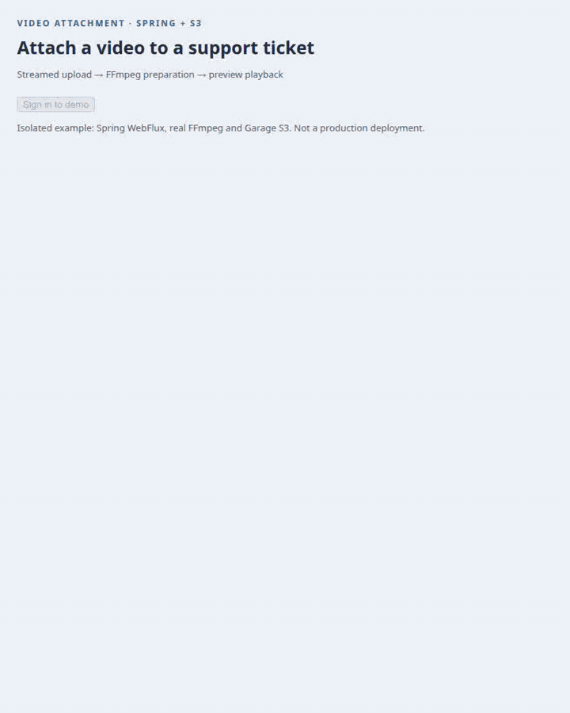

# video-streams-react

Stream a video attachment from upload to playback. Two ready React components connect existing file streaming, server preparation and HLS playback without a complete-video Blob.

<picture><source media="(prefers-reduced-motion: reduce)" srcset="assets/visuals/attachment-spring-en.png"></picture>

[Static image](assets/visuals/attachment-spring-en.png) · [Русская запись](assets/visuals/attachment-spring-ru.gif) · [Guide](docs/README.md) · [Versions](docs/versions/README.md) · MIT

<details name="readme-language" open><summary><picture><source media="(prefers-color-scheme: dark)" srcset="assets/lang-en-dark.svg"></picture></summary>

For applications with video messages, support tickets or training attachments. `VideoAttachment` shows source upload, server preparation and playback as separate stages. `VideoStreamPlayer` opens an already prepared video.

## Get started in your project

```json
{
  "dependencies": {
    "@59alex/video-streams-react": "^0.1.0",
    "@59alex/video-streams": "^0.1.0",
    "@59alex/file-streams-react": "^0.1.0",
    "@59alex/file-streams": "^0.1.0",
    "react": "^18.3.1 || ^19.0.0",
    "react-dom": "^18.3.1 || ^19.0.0"
  }
}
```

These 0.1.0 packages are available as source; npm publication is pending. [Local artifact workflow and runnable demo](CONTRIBUTING.md).

```tsx
import { VideoAttachment } from '@59alex/video-streams-react';
import '@59alex/video-streams-react/styles.css';

const key = `${account.id}:${attachmentId}`;
<VideoAttachment
  scope={account.id}
  objectKey={key}
  objectsUrl="/api/video-sources"
  prepareUrl={`/api/videos/${encodeURIComponent(key)}/prepare`}
  headers={{ [account.csrfHeader]: account.csrfToken }}
  onPrepared={saveVideoReference}
/>;
```

`account` comes from your authenticated application. `attachmentId` is a stable identifier for this new attachment; `saveVideoReference` receives metadata for your application. The server authorizes the same key, prepares FFmpeg output and serves **every** protected playlist/segment request. [Complete React source](examples/spring-react/VideoMessage.tsx) · [Spring controller and configuration](https://github.com/dlorian59/video-streams-spring-boot-starter/tree/main/examples/secured-video) · [Paired integration walkthrough](docs/en/integration.md).

## What you can do

| Task | Component or API | Example and result |
|---|---|---|
| Attach a video | `VideoAttachment` | [Upload → prepare → watch](docs/en/integration.md): no manual file stream or playback lifecycle glue. |
| Open a saved video | `VideoStreamPlayer` | [Existing attachment](docs/en/components.md#open-an-existing-video): short initial preload and native video controls. |
| Seek or stop loading | Player controls | [Visual guide](docs/en/components.md#seek-stop-and-retry): fetch the requested region; release the session on close. |
| Protect account changes | Required `scope` | [Ownership](docs/en/components.md#account-and-lifecycle): old results and requests do not become the new account's video. |
| Reuse custom authorization | `createVideoStreams` | [Authenticated player](docs/en/components.md#custom-transport): request-aware headers or your application's fetch wrapper. |
| Handle uncertain preparation | Explicit outcome | [Errors and recovery](docs/en/integration.md#errors-and-recovery): a saved source and a ready video are different facts. |

The animation shows a real 32-second video uploaded through Spring WebFlux to Garage S3, prepared by FFmpeg and played through HLS. It requests 3 of 16 segments before play, then seeks to 24 seconds. A four-second preview is a target: this run buffered six seconds. The separate standalone player fixture is identified in its guide. Neither the target nor the loader's per-response byte cap is a hard browser-memory ceiling.

V1 supports one unencrypted fMP4 HLS VOD rendition through hls.js. No automatic full-file fallback, native HLS mode, ABR, DRM, durable job queue or full-video cache. React 18.3+ and React 19 share the same client entry; no React 19-only import is required. [API reference](docs/en/reference.md).

</details>

<details name="readme-language"><summary><picture><source media="(prefers-color-scheme: dark)" srcset="assets/lang-ru-dark.svg"></picture></summary>

Для видеосообщений, обращений в поддержку и учебных вложений. `VideoAttachment` отдельно показывает загрузку исходника, подготовку на сервере и воспроизведение. `VideoStreamPlayer` открывает уже подготовленное видео.

## Подключение в существующий проект

Добавьте в `package.json`:

```json
{"dependencies":{"@59alex/video-streams-react":"^0.1.0","@59alex/video-streams":"^0.1.0","@59alex/file-streams-react":"^0.1.0","@59alex/file-streams":"^0.1.0","react":"^18.3.1 || ^19.0.0","react-dom":"^18.3.1 || ^19.0.0"}}
```
 Версия 0.1.0 пока доступна как исходники; npm-публикация ожидается. [Локальные артефакты и запуск примера](CONTRIBUTING.md).

```tsx
import { VideoAttachment } from '@59alex/video-streams-react';
import '@59alex/video-streams-react/styles.css';

const key = `${account.id}:${attachmentId}`;
<VideoAttachment
  scope={account.id}
  objectKey={key}
  objectsUrl="/api/video-sources"
  prepareUrl={`/api/videos/${encodeURIComponent(key)}/prepare`}
  headers={{ [account.csrfHeader]: account.csrfToken }}
  language="ru"
  onPrepared={saveVideoReference}
/>;
```

`account` получает ваше авторизованное приложение. `attachmentId` — постоянный идентификатор нового вложения; `saveVideoReference` получает метаданные для приложения. Сервер проверяет права на тот же ключ, готовит результат FFmpeg и защищает **каждый** запрос плейлиста или сегмента. [Полный React-код](examples/spring-react/VideoMessage.tsx) · [Spring controller и конфигурация](https://github.com/dlorian59/video-streams-spring-boot-starter/tree/main/examples/secured-video) · [Сквозное руководство](docs/ru/integration.md).

## Возможности

| Задача | Компонент или API | Пример и результат |
|---|---|---|
| Прикрепить видео | `VideoAttachment` | [Загрузка → подготовка → просмотр](docs/ru/integration.md): поток и жизненный цикл плеера уже связаны. |
| Открыть сохранённое видео | `VideoStreamPlayer` | [Готовое вложение](docs/ru/components.md#открыть-готовое-видео): короткая предзагрузка и стандартные controls. |
| Перемотать и остановить | Кнопки плеера | [Визуальное руководство](docs/ru/components.md#перемотка-остановка-повтор): запрашивается нужная область, при закрытии освобождается сессия. |
| Сменить аккаунт | Обязательный `scope` | [Владение сессией](docs/ru/components.md#аккаунт-и-жизненный-цикл): старые запросы и результаты не переходят новому владельцу. |
| Подключить свою авторизацию | `createVideoStreams` | [Свой transport](docs/ru/components.md#свой-transport): заголовки для каждого запроса или fetch приложения. |
| Разобраться с обрывом подготовки | Явный результат | [Ошибки и восстановление](docs/ru/integration.md#ошибки-и-восстановление): сохранённый исходник ещё не означает готовое видео. |

На записи — настоящее 32-секундное видео: загрузка через Spring WebFlux в Garage S3, подготовка FFmpeg и просмотр HLS. До Play получены 3 из 16 сегментов, затем выполнена перемотка к 24-й секунде. Цель предзагрузки — четыре секунды; буфер составил шесть. Отдельная HTTP-фикстура плеера обозначена в руководстве. Это не жёсткий предел памяти браузера.

V1 поддерживает один незашифрованный вариант fMP4 HLS VOD через hls.js. Нет автоматического fallback на целый файл, native HLS, ABR, DRM, устойчивой очереди заданий или кэша всего видео. Один client entry совместим с React 18.3+ и React 19. [Справочник API](docs/ru/reference.md).

</details>
