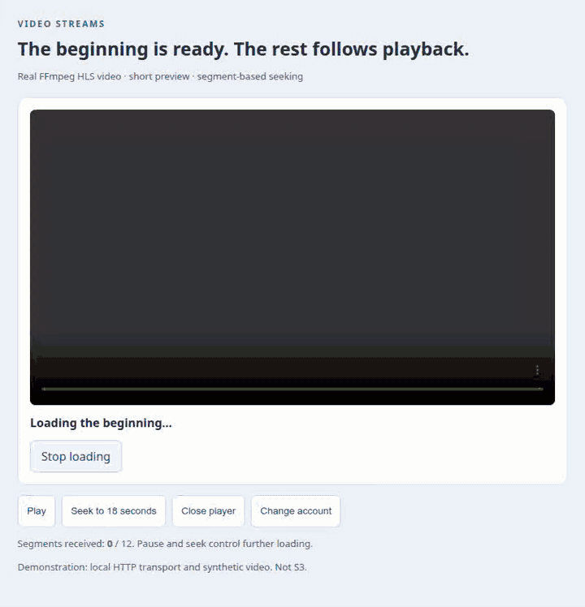

# Components and scenarios

[← Guides](../README.md) · [Русский](../ru/components.md) · [Reference](reference.md)

## Open an existing video

```tsx
<VideoStreamPlayer playlistUrl={savedVideo.playlistUrl} scope={account.id} />
```

The player loads a short beginning without autoplay. The browser's standard controls provide play, pause, seeking, volume and fullscreen. Put caption `<track>` children inside the component when your application supplies captions. [Runnable source](../../examples/player/main.tsx).

<picture><source media="(prefers-reduced-motion: reduce)" srcset="../../assets/visuals/playback-en.png"></picture>

[Static image](../../assets/visuals/playback-en.png). The generated H264/AAC fixture contains 12 segments; preview requested three. `receivedBytes` counts network bytes, not decoded frames or durable storage commits.

## Upload and prepare a video

```tsx
<VideoAttachment objectKey={key} scope={account.id}
  objectsUrl="/api/video-sources"
  prepareUrl={`/api/videos/${encodeURIComponent(key)}/prepare`}
  headers={{ [account.csrfHeader]: account.csrfToken }}
  onPrepared={saveVideoReference} />
```

The original file is streamed by FileAttachment. Its confirmed result triggers one preparation request. Only a validated ready result mounts the player. [Full commented source](../../examples/spring-react/VideoMessage.tsx) · [Server + UI walkthrough](integration.md).

<picture><source media="(prefers-reduced-motion: reduce)" srcset="../../assets/visuals/attachment-spring-en.png"></picture>

[PNG](../../assets/visuals/attachment-spring-en.png). Real Spring WebFlux → Garage S3 → FFmpeg preparation → HLS playback. Source: 7,374,595 bytes / 32 seconds; only 3 of 16 segments requested before Play. [Verification](../../CONTRIBUTING.md#verification).

## Seek, stop and retry

```tsx
<VideoStreamPlayer playlistUrl={savedVideo.playlistUrl} scope={account.id}
  preload="none" onState={observePlayback} />
```

`none` allows manifest inspection but waits for Play before loading media fragments. The native seek control moves to another playback region. Stop loading disposes the current session; Retry playback creates a fresh GET session. No POST, upload or full Blob fallback is involved. The recording shows seek to 18 seconds and closing the component. [Runnable controls source](../../examples/player/main.tsx).

## Account and lifecycle

```tsx
<VideoStreamPlayer key={attachment.id} scope={account.id}
  playlistUrl={attachment.playlistUrl} />
```

The component itself remounts its owned player on scope or URL changes. Cleanup aborts requests, destroys hls.js and releases the media element. One session owns one element; sharing a MediaSource URL between players is not supported. Do not defer scope changes. StrictMode mount/cleanup/reconnect is supported. [Implementation](../../src/player.tsx).

## Custom transport

```tsx
const client = createVideoStreams({
  headers: ({ url, method, signal, scope }) => requestHeaders({ url, method, signal, scope }),
});
<VideoStreamPlayer client={client} scope={account.id} playlistUrl={asset.playlistUrl} />;
```

Create the client once or memoize it. The application supplies fresh headers; a custom `fetch` may implement its existing proof/token flow. URL credentials are rejected, redirects are disabled, and only the document origin is trusted unless `allowedOrigins` explicitly adds another origin. Those origins may receive the supplied headers. No private application authentication mechanism is embedded in this library.

Use advanced `VideoAttachment.prepare(commit, signal)` instead of `prepareUrl` when an existing SDK already performs preparation. It must return the same typed `PreparedVideo` contract and honor cancellation. Never supply both options. [API](reference.md).
