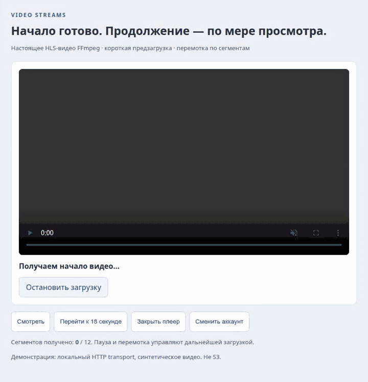

# Компоненты и сценарии

[← Руководства](../README.md) · [English](../en/components.md) · [Справочник](reference.md)

## Открыть готовое видео

```tsx
<VideoStreamPlayer playlistUrl={savedVideo.playlistUrl} scope={account.id} language="ru" />
```

Плеер получает короткое начало без autoplay. Стандартные controls браузера дают просмотр, паузу, перемотку, громкость и fullscreen. Если приложение предоставляет субтитры, передайте дочерний `<track>`. [Рабочий исходник](../../examples/player/main.tsx).

<picture><source media="(prefers-reduced-motion: reduce)" srcset="../../assets/visuals/playback-ru.png"></picture>

[Статичное изображение](../../assets/visuals/playback-ru.png). В созданной H264/AAC-фикстуре 12 сегментов; preview запросил три. `receivedBytes` — сетевые байты, а не количество декодированных кадров или подтверждение записи в хранилище.

## Загрузить и подготовить видео

```tsx
<VideoAttachment objectKey={key} scope={account.id}
  objectsUrl="/api/video-sources"
  prepareUrl={`/api/videos/${encodeURIComponent(key)}/prepare`}
  headers={{ [account.csrfHeader]: account.csrfToken }}
  language="ru" onPrepared={saveVideoReference} />
```

FileAttachment передаёт исходный файл потоком. После подтверждения запускается один запрос подготовки. Плеер появляется только после готового результата. [Полный код с комментариями](../../examples/spring-react/VideoMessage.tsx) · [Сервер и UI вместе](integration.md).

<picture><source media="(prefers-reduced-motion: reduce)" srcset="../../assets/visuals/attachment-spring-ru.png"></picture>

[PNG](../../assets/visuals/attachment-spring-ru.png). Настоящий Spring WebFlux → Garage S3 → подготовка FFmpeg → HLS-просмотр. Исходник: 7 374 595 байт / 32 секунды; до Play запрошены только 3 из 16 сегментов. [Проверка](../../CONTRIBUTING.md#verification).

## Перемотка, остановка, повтор

```tsx
<VideoStreamPlayer playlistUrl={savedVideo.playlistUrl} scope={account.id}
  preload="none" onState={observePlayback} language="ru" />
```

`none` разрешает чтение плейлиста, но ждёт Play перед загрузкой media fragments. Стандартная перемотка выбирает другой участок. «Остановить загрузку» освобождает сессию, повтор создаёт новую GET-сессию. POST, загрузка исходника и полный Blob не повторяются. На записи — переход к 18-й секунде и закрытие компонента. [Код controls](../../examples/player/main.tsx).

## Аккаунт и жизненный цикл

```tsx
<VideoStreamPlayer key={attachment.id} scope={account.id}
  playlistUrl={attachment.playlistUrl} />
```

Компонент пересоздаёт свою сессию при смене scope или URL. Cleanup отменяет запросы, уничтожает hls.js и освобождает media element. Одна сессия владеет одним элементом; общий MediaSource URL между плеерами не используется. Не откладывайте смену scope. Поддерживается mount/cleanup/reconnect в StrictMode. [Реализация](../../src/player.tsx).

## Свой transport

```tsx
const client = createVideoStreams({
  headers: ({ url, method, signal, scope }) => requestHeaders({ url, method, signal, scope }),
});
<VideoStreamPlayer client={client} scope={account.id} playlistUrl={asset.playlistUrl} />;
```

Создайте клиент один раз или мемоизируйте его. Приложение выдаёт свежие headers; свой `fetch` может использовать уже существующий token/proof flow. Credentials в URL запрещены, redirect отключён, разрешён только origin документа, пока `allowedOrigins` явно не добавит другой. Дополнительный origin сможет получить переданные заголовки. Частной авторизации приложения внутри библиотеки нет.

Если подготовку уже делает SDK, передайте `VideoAttachment.prepare(commit, signal)` вместо `prepareUrl`. Он возвращает типизированный `PreparedVideo` и учитывает отмену. Одновременная передача обеих опций запрещена. [API](reference.md).
